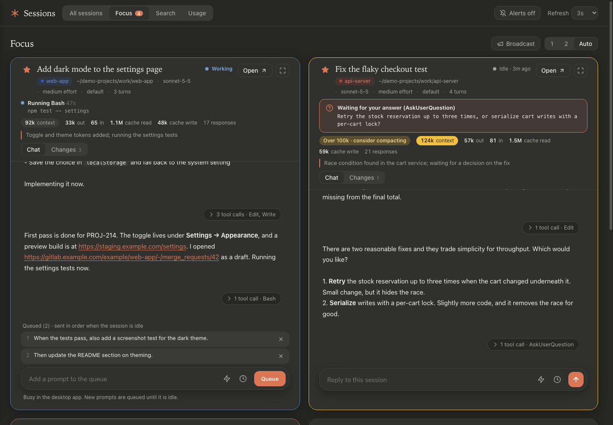
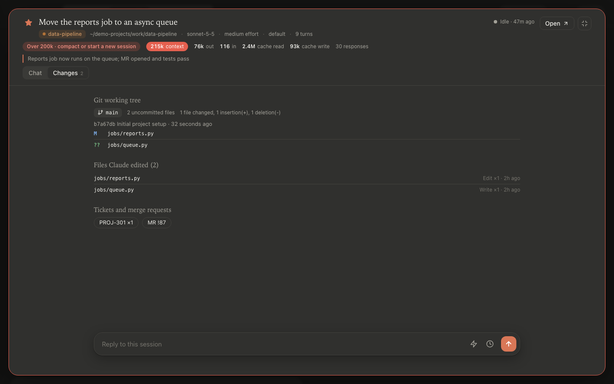
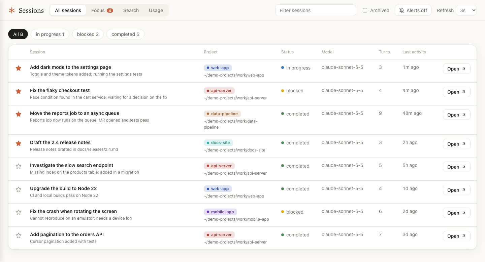
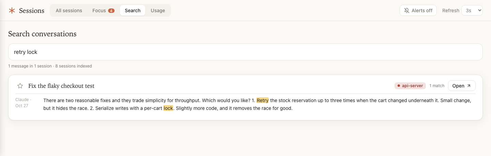
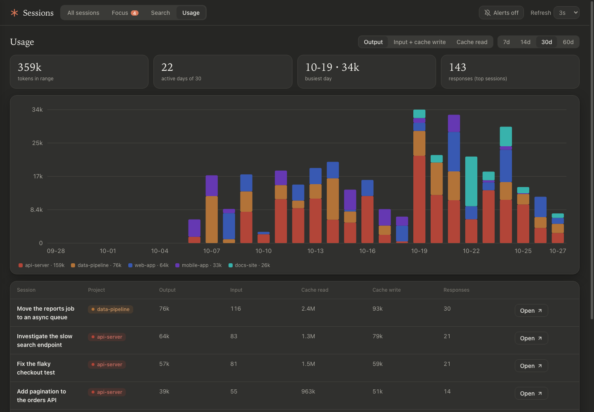

# Claude Session Board

Local web app that lists your Claude desktop Code sessions, opens any of them in the desktop app, and shows live cards for the ones you star.

> Unofficial community project. It is not made by, affiliated with or endorsed by Anthropic. It reads the files the Claude desktop app and Claude Code already write on your machine, and those formats are undocumented and may change without notice.

## Screenshots

All screenshots use the fictional sessions from `npm run demo`. No real conversations are shown.

### Focus: one big chat and a list of the sessions you star

A sidebar lists starred sessions grouped as Needs you, Working and Idle. The selected one fills the page as a single chat with expandable tool calls, a live "now running" strip, token usage with context warnings, the prompt queue and a prompt box. A session that ended on an unanswered question is flagged in the sidebar and in the chat. The URL keeps the selected session after a reload (`?card=`).



### Changes: git state, edited files, tickets and merge requests



### All sessions



### Search inside every conversation



### Usage over time



## Requirements

- Node.js 20 or newer. There are no dependencies to install.
- The Claude desktop app (Code tab) and the `claude` CLI on your PATH, for sending prompts.
- macOS paths are the defaults. On another system set `SESSIONS_DIR` and `PROJECTS_DIR` (see Configuration).

## Run

```bash
npm start
```

Then open http://localhost:4747. Run `npm test` for the unit tests.

### Start the server at login (macOS)

An installed PWA cannot start the server itself. Install a LaunchAgent so the server starts at login and restarts if it dies, and the PWA always finds it running:

```bash
./scripts/install-launch-agent.sh
```

- The agent is `com.user.claude-session-board`. It runs `server.js` with the `node` on your PATH at install time, so rerun the script after switching Node versions.
- Logs go to `~/Library/Logs/claude-session-board.log`.
- Restart after changing server code: `launchctl kickstart -k gui/$(id -u)/com.user.claude-session-board`. Prompts the board is running keep going through a restart (each runs in its own process group, and the agent sets `AbandonProcessGroup`), so a session can restart the board without killing itself. The new server does not track them, though: it shows them as Working from their transcripts, and their run status, queue pause and handoff opening are not reported.
- Remove it with `./scripts/install-launch-agent.sh uninstall`.

### Run it as its own app (macOS)

`electron/` wraps the board in a standalone window with its own Dock icon, no browser chrome and the page's top bar as the title bar. The board itself is unchanged and keeps running as the launch agent (or the app starts the server itself if it is not running).

```bash
./electron/build.sh
```

This writes `electron/out/Claude Session Board-darwin-<arch>/Claude Session Board.app` (Electron is installed into `electron/node_modules`, the board's own folder stays dependency-free). Drag the app to Applications, or `open` it. The app points at this repo, so **code changes need no rebuild**: while it runs it reloads the window when a file in `public/` changes and restarts the server (then reloads) when `server.js` or `lib/` change. Turn that off with View → Auto reload on code changes. Runs keep going through a server restart. Move the repo and you must rerun `build.sh`, or set `BOARD_REPO`. `claude://` Open links and other links open outside the app, and the installed-browser service worker is switched off inside it.

### Use it from your phone (Tailscale)

The server only listens on `127.0.0.1`. To reach it remotely, `tailscale serve` publishes it as HTTPS on your **private tailnet** (never Funnel, which is public), and the board asks for an access token from anything arriving through that hostname. localhost stays login-free.

1. Install Tailscale on the Mac and the phone, sign both into the same account, and enable HTTPS certificates (admin console → DNS).
2. Run `./scripts/enable-remote.sh`. It writes `data/remote.json` (hostname and a random token, mode 600), starts `tailscale serve`, restarts the launch agent, and prints the URL and token.
3. On the phone, with Tailscale on, open `https://<mac>.<tailnet>.ts.net/`, enter the token once (the login cookie lasts a year), then Share → Add to Home Screen.

`./scripts/enable-remote.sh rotate` makes a new token and signs every device out; `disable` turns it all off. The Mac must be awake and the board running (use the launch agent). Prompts sent from the phone run on the Mac with the same permission mode as local ones, so treat the token like a password. Things that open windows on the Mac (the Finder folder picker, Open in Claude) act on the Mac, not the phone.

#### Or through a Cloudflare quick tunnel

`./scripts/enable-cloudflare.sh` starts `cloudflared tunnel` (no Cloudflare account needed), writes the `*.trycloudflare.com` hostname and a token to `data/remote.json`, restarts the board and prints the URL. **This address is public on the internet** and the token login is the only protection (failed logins are rate-limited per client address), so keep the token secret and use `rotate` if it leaks. The address changes whenever cloudflared restarts (reboot, `disable`), so rerun the script then; for a stable address use a named tunnel on your own domain and set `REMOTE_HOSTS`. `./scripts/enable-cloudflare.sh disable` stops the tunnel and turns remote login off.

### Try it without Claude desktop

```bash
npm run demo
```

This generates fictional sessions, transcripts and git repositories in a temporary folder (`DEMO_DIR` to choose another) and starts the board on `PORT` (default 4747). Prompts are not sent anywhere in demo mode.

## Pages

- `/` all sessions. Search, status filter and the archived toggle are kept in the URL (`?q=`, `?status=`, `?archived=1`).
- `/focus` a sidebar of starred sessions (filter, ↑ ↓ to switch, `/` to filter) and one large chat for the selected session. The selection is remembered.
- **New chat** (top of the Focus sidebar) opens an empty chat in the page, like the desktop app's new session screen: choose a project from the dropdown (or **Other folder…**, which opens the Finder folder picker) and write the first prompt. Attach files and images with the paperclip, by pasting, or by dragging them onto the card (the chat, header or prompt box; a dashed outline shows the drop zone), as on a session card; their paths are added to the first prompt. The ↗ button (Open in Claude) opens the desktop app on that folder with the prompt filled in; you press send there, and the session joins Focus once the app records it. Esc cancels, and the draft text is kept while you look at other sessions.
- **New chat → Start here (board only)** (Enter) runs the first prompt right away as `claude -p --session-id <uuid>` in the folder you pick. The row above the prompt box sets the model, effort (low to max) and permission mode; empty uses the CLI default and `PROMPT_PERMISSION_MODE`, and the session keeps its choices for every later prompt. The desktop app has no way to receive a prompt automatically (its `claude://code/new` link only pre-fills the box), and it only lists sessions it created itself, so these sessions live on the board only. They are kept in `data/board-sessions.json`, join Focus at once, and carry a "board only" label. Prompts, the queue, schedules, search and usage work like any other session. The Open button becomes **Copy resume** (`cd <folder> && claude --resume <id>`, to continue it in a terminal), and **Move to desktop** runs `/handoff` and opens a real desktop session with the handoff document.
- `/search` full-text search inside every conversation, grouped by session with highlighted snippets. A project dropdown narrows it to one project (`?project=`).
- `/usage` tokens per day and per project (stacked chart) plus the top sessions.
- `/skills` every installed skill (global, plugin and per-project) with uses over 7, 30 or 90 days, a Hot/Warm/Cooling/Cold/Unused temperature from when it was last used, and a detail row with the trend, projects, recent sessions and the `SKILL.md` body. Uses are counted from `Skill` tool calls and slash commands in the main conversation.

## Focus chat

- Chat with full-length messages and expandable tool calls (full commands).
- Live strip: the tool Claude is running now with a ticking timer, thinking or writing state, and running subagents.
- Attention banner when a transcript ends on an unanswered question (AskUserQuestion, ExitPlanMode) or a tool has been pending for 45s or more, which usually means it is waiting for approval.
- Token usage with a yellow warning at 100k context and red at 200k.
- Changes tab: git branch, ahead and behind, uncommitted files and diff size for the session folder, the files Claude edited, ticket keys (set `JIRA_BASE_URL` to link them; set `GITLAB_HOST` to your GitLab hostname for the Merge requests tab, which uses `glab`) and merge request links mentioned in the chat.
- Attach files and images with the paperclip, by pasting, or by dragging them onto the card (the chat, header or prompt box; a dashed outline shows the drop zone) (25 MB each). They are saved under `data/uploads/` (deleted after 7 days) and their paths are added to the prompt, so Claude reads them from disk.
- Prompt box with a queue, ⚡ shortcuts (stored in `data/snippets.json`) and ⏰ scheduling (once, daily, weekdays or weekly).
- 📣 Broadcast queues one prompt on several focused sessions.

## Schedule tab

The Schedule tab (`/schedule`) holds routines: a project folder, a prompt, a time, a repeat (once, every day, weekdays, or every week on a chosen day) and the same model, effort, Chrome and permission choices as New chat. Every time a routine fires, the board starts a new board-only session in that folder and adds it to Focus, so each run has its own conversation. "Run now" fires one immediately, Pause stops it, and the last run links to its session. Routines live in `data/routines.json`. The board must be running at the time; a missed time fires once on the next start and then moves to the next slot.

## Prompts, queue and schedules

- Prompts run as headless `claude -p --resume <id>` in the session folder with `PROMPT_PERMISSION_MODE` (default `bypassPermissions`, so prompts sent from this page edit files and run commands without asking). Set it to `default` to deny tools that need approval, or `acceptEdits` to allow edits only. Only run this on a machine you trust, and never expose the server beyond localhost except through the token-protected remote access below.
- While a prompt is running, or the session is busy in the desktop app, new prompts are queued and sent in order when it is idle. A failed or stopped run pauses the queue until you press Resume.
- Queues persist in `data/queue.json` and schedules in `data/schedules.json`. Due schedules are added to the queue, so they follow the same rules.
- The desktop app may not show turns sent from the board until you reopen the session.

## Slash commands

Typing `/` in a card's prompt box opens an autocomplete list of the commands that work in headless runs: your project commands (`<session folder>/.claude/commands`), your user commands (`~/.claude/commands`), skills, enabled plugin commands and skills, and the built-ins `/compact`, `/context`, `/cost` and `/model`. Arrow keys move, Tab or Enter completes, Esc closes.

- Custom commands and skills run as normal turns.
- Output from `/context`, `/cost` and `/model` is shown in the chat as a command panel.
- `/clear`, `/reset` and `/new` are refused, because headless mode answers them by starting a new session and the board would lose track of the old one.
- Interactive-only commands such as `/help`, `/status` and `/config` are not available in headless mode.

## Alerts

The 🔔 button turns on toasts, a short beep, browser notifications and a tab-title counter when a focused session finishes, asks a question, may need approval, is marked blocked, or a prompt fails or pauses the queue.

## Configuration

- `PORT` (default `4747`), `SESSIONS_DIR`, `PROJECTS_DIR`, `DATA_DIR`
- `PROMPT_PERMISSION_MODE`, `CLAUDE_BIN`, `JIRA_BASE_URL`
- `REMOTE_HOSTS` and `BOARD_TOKEN` override `data/remote.json` (comma-separated hostnames; the token must be 24+ characters). Remote hosts without a token stop the server from starting.
- `CLAUDE_HOME` (where `.claude/commands`, `.claude/skills` and `.claude/plugins` are read from, default your home folder)

The server binds to `127.0.0.1`, rejects Host headers other than localhost and the configured remote hosts (which need the login cookie, with failed logins rate-limited), and only accepts POSTs from its own origin. It reads session files and transcripts and never edits them.

## License

[MIT](LICENSE)
