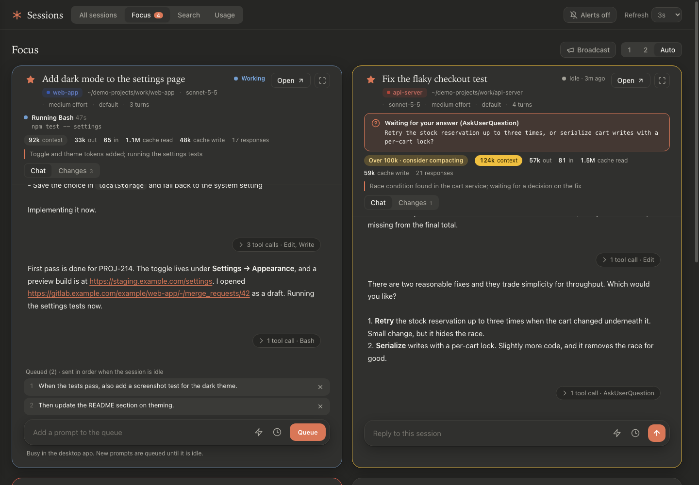
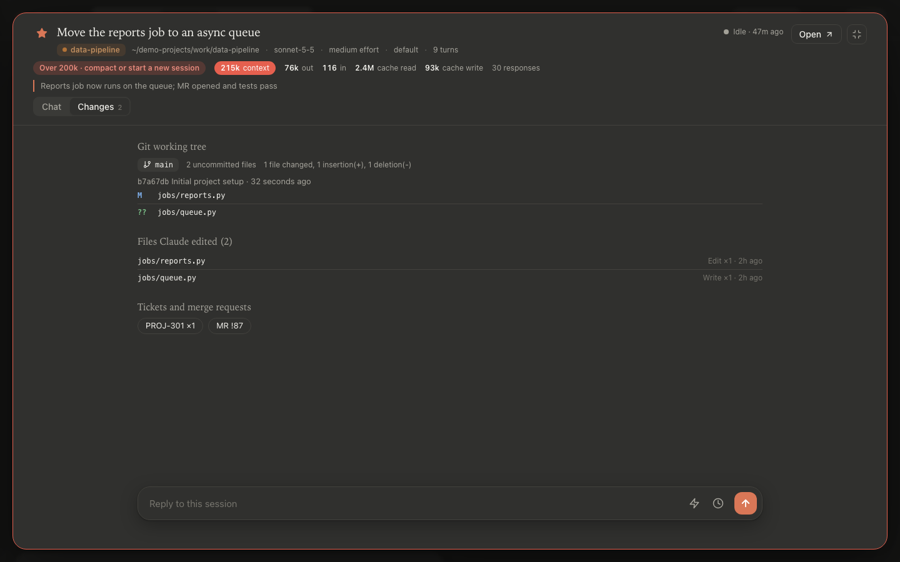
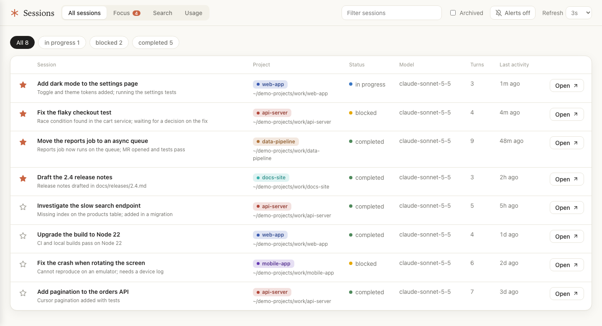
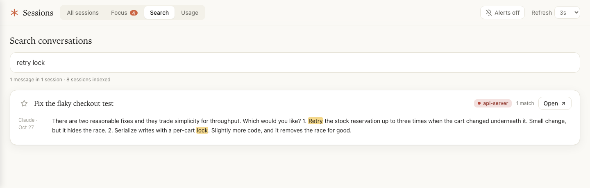
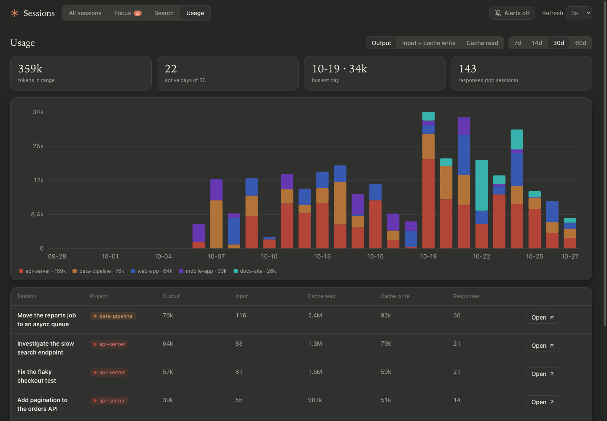

# Claude Session Board

Local web app that lists your Claude desktop Code sessions, opens any of them in the desktop app, and shows live cards for the ones you star.

> Unofficial community project. It is not made by, affiliated with or endorsed by Anthropic. It reads the files the Claude desktop app and Claude Code already write on your machine, and those formats are undocumented and may change without notice.

## Screenshots

All screenshots use the fictional sessions from `npm run demo`. No real conversations are shown.

### Focus: one big chat and a list of the sessions you star

A sidebar lists starred sessions grouped as Needs you, Working and Idle. The selected one fills the page as a single chat with expandable tool calls, a live "now running" strip, token usage with context warnings, the prompt queue and a prompt box. A session that ended on an unanswered question is flagged in the sidebar and in the chat. The URL keeps the selected session after a reload (`?card=`).



### Changes: git state, edited files, tickets and merge requests



### All sessions



### Search inside every conversation



### Usage over time



## Requirements

- Node.js 20 or newer. There are no dependencies to install.
- The Claude desktop app (Code tab) and the `claude` CLI on your PATH, for sending prompts.
- macOS paths are the defaults. On another system set `SESSIONS_DIR` and `PROJECTS_DIR` (see Configuration).

## Run

```bash
npm start
```

Then open http://localhost:4747. Run `npm test` for the unit tests.

### Start the server at login (macOS)

An installed PWA cannot start the server itself. Install a LaunchAgent so the server starts at login and restarts if it dies, and the PWA always finds it running:

```bash
./scripts/install-launch-agent.sh
```

- The agent is `com.user.claude-session-board`. It runs `server.js` with the `node` on your PATH at install time, so rerun the script after switching Node versions.
- launchd does not pass your shell exports. The installer copies these variables into the plist's `EnvironmentVariables` if they are set in the shell you run it from: `GITLAB_HOST`, `JIRA_BASE_URL`, `JIRA_EMAIL`, `JIRA_API_TOKEN`, `FLOW_JQL`, `PORT`, `PROMPT_PERMISSION_MODE`, `REVIEW_SLACK_CHANNEL`, `REMOTE_HOSTS`, `BOARD_TOKEN`, `CLAUDE_APP_ASAR`, `CLAUDE_BIN`, `CLAUDE_HOME`, `DATA_DIR`, `SESSIONS_DIR`, `PROJECTS_DIR`, `PING_DUE_HOURS`. Values already in an installed plist that your shell does not set are kept, a variable set in your shell replaces the old value, and `PATH` is always rebuilt. Export what you need and rerun the installer to change them (for example `GITLAB_HOST=gitlab.example.com ./scripts/install-launch-agent.sh`). The plist is written readable only by you, since it can hold tokens.
- Logs go to `~/Library/Logs/claude-session-board.log`.
- Restart after changing server code: `launchctl kickstart -k gui/$(id -u)/com.user.claude-session-board`. Prompts the board is running keep going through a restart (each runs in its own process group, and the agent sets `AbandonProcessGroup`), so a session can restart the board without killing itself. The new server does not track them, though: it shows them as Working from their transcripts, and their run status, queue pause and handoff opening are not reported.
- Remove it with `./scripts/install-launch-agent.sh uninstall`.

### Run it as its own app (macOS)

`electron/` wraps the board in a standalone window with its own Dock icon, no browser chrome and the sidebar's head (plus a thin strip along the top of the page) as the draggable title bar. The board itself is unchanged and keeps running as the launch agent (or the app starts the server itself if it is not running).

```bash
./electron/build.sh
```

This writes `electron/out/Claude Session Board-darwin-<arch>/Claude Session Board.app` (Electron is installed into `electron/node_modules`, the board's own folder stays dependency-free). Drag the app to Applications, or `open` it. The app points at this repo, so **code changes need no rebuild**: while it runs it reloads the window when a file in `public/` changes and restarts the server (then reloads) when `server.js` or `lib/` change. Turn that off with View → Auto reload on code changes. Runs keep going through a server restart. Move the repo and you must rerun `build.sh`, or set `BOARD_REPO`. `claude://` Open links and other links open outside the app, and the installed-browser service worker is switched off inside it.

### Use it from your phone (Tailscale)

The server only listens on `127.0.0.1`. To reach it remotely, `tailscale serve` publishes it as HTTPS on your **private tailnet** (never Funnel, which is public), and the board asks for an access token from anything arriving through that hostname. localhost stays login-free.

1. Install Tailscale on the Mac and the phone, sign both into the same account, and enable HTTPS certificates (admin console → DNS).
2. Run `./scripts/enable-remote.sh`. It writes `data/remote.json` (hostname and a random token, mode 600), starts `tailscale serve`, restarts the launch agent, and prints the URL and token.
3. On the phone, with Tailscale on, open `https://<mac>.<tailnet>.ts.net/`, enter the token once (the login cookie lasts a year), then Share → Add to Home Screen.

`./scripts/enable-remote.sh rotate` makes a new token and signs every device out; `disable` turns off remote access through Tailscale only. `scripts/enable-cloudflare.sh` and `scripts/enable-remote.sh` each add and remove only their own hostname (`*.trycloudflare.com` and `*.ts.net`) in `data/remote.json`, so running both keeps both hosts, and `data/remote.json` is deleted only when no host is left. The Mac must be awake and the board running (use the launch agent). Prompts sent from the phone run on the Mac with the same permission mode as local ones, so treat the token like a password. Things that open windows on the Mac (the Finder folder picker, Open in Claude) act on the Mac, not the phone.

#### Or through a Cloudflare quick tunnel

`./scripts/enable-cloudflare.sh` starts `cloudflared tunnel` (no Cloudflare account needed), writes the `*.trycloudflare.com` hostname and a token to `data/remote.json`, restarts the board and prints the URL. **This address is public on the internet** and the token login is the only protection (failed logins are rate-limited per client address), so keep the token secret and use `rotate` if it leaks. The address changes whenever cloudflared restarts (reboot, `disable`), so rerun the script then; for a stable address use a named tunnel on your own domain and set `REMOTE_HOSTS`. `./scripts/enable-cloudflare.sh disable` stops the tunnel and turns remote login off.

### Try it without Claude desktop

```bash
npm run demo
```

This generates fictional sessions, transcripts and git repositories in a temporary folder (`DEMO_DIR` to choose another) and starts the board on `PORT` (default 4747). Prompts are not sent anywhere in demo mode.

## Pages

- `/` all sessions. Search, status filter and the archived toggle are kept in the URL (`?q=`, `?status=`, `?archived=1`).
- `/focus` a sidebar of starred sessions (filter, ↑ ↓ to switch, `/` to filter) and one large chat for the selected session. The selection is remembered.
- **New chat** (top of the Focus sidebar) opens an empty chat in the page, like the desktop app's new session screen: choose a project from the dropdown (or **Other folder…**, which opens the Finder folder picker) and write the first prompt. Attach files and images with the paperclip, by pasting, or by dragging them onto the card (the chat, header or prompt box; a dashed outline shows the drop zone), as on a session card; their paths are added to the first prompt. The ↗ button (Open in Claude) opens the desktop app on that folder with the prompt filled in; you press send there, and the session joins Focus once the app records it. Esc cancels, and the draft text is kept while you look at other sessions.
- **New chat → Start here (board only)** (Enter) runs the first prompt right away as `claude -p --session-id <uuid>` in the folder you pick. The row above the prompt box sets the model, effort (low to max) and permission mode; empty uses the CLI default and `PROMPT_PERMISSION_MODE`, and the session keeps its choices for every later prompt. The desktop app has no way to receive a prompt automatically (its `claude://code/new` link only pre-fills the box), and it only lists sessions it created itself, so these sessions live on the board only. A board session starts with its first prompt as its name; when that first run finishes, the board asks `claude -p --model haiku` (no session saved) for a 3 to 7 word title and renames the session, and keeps the first-prompt name if that call fails. They are kept in `data/board-sessions.json`, join Focus at once, and carry a "board only" label. The list holds up to 200; when it is full, a new one drops the least recently used board sessions that are not in Focus, running, queued, scheduled, babysitting an MR, checking a deploy, or an open side chat (or its parent). A dropped session leaves the board, but its transcript stays and `claude --resume` still opens it. Prompts, the queue, schedules, search and usage work like any other session. The Open button becomes **Copy resume** (`cd <folder> && claude --resume <id>`, to continue it in a terminal), and **Move to desktop** runs `/handoff` and opens a real desktop session with the handoff document.
- **Questions from a board run.** When a board run calls `AskUserQuestion`, or an MCP server asks to confirm (an elicitation, e.g. Supabase before `apply_migration`), the run waits and a card appears above the prompt box. A question card shows each question with its options (one choice, or any number for a multi-select question) and an Other box for your own answer, like Claude desktop. **Submit** sends your answers back to the waiting run, and **Skip** declines so Claude carries on without them. The session moves to Needs you in the sidebar and raises an alert. Board runs speak stream-json with `--permission-prompt-tool stdio`: the CLI sends the question as a `can_use_tool` request and the board answers with the tool's input plus `answers`. Every other permission request is still denied.
- **Babysit** and **Fix** (merge requests page, your own open MRs) start a new board-only session in a checkout of the MR's repository, found by matching the project to the `origin` remote of your known session folders (the session that mentioned the MR is tried first). The new session appears in Focus. No matching folder, no buttons. The session never switches branches in that checkout: if it is on another branch it works in a git worktree of the MR branch. Babysit's prompt is `/csb-babysit <MR url>`. The skill (`skills/csb-babysit`, link it into `~/.claude/skills`) watches the pipeline, fixes a failed one on the MR branch (at most three fix pushes), adds `Ready for review` when it passes and `Ready to merge` once the MR is approved, and stops with a notification and a question when a human is needed (infrastructure failures, conflicts, unresolved threads, a draft, a repeated failure). Between checks it asks the board to send the session the next one (`POST /api/schedule`, every 4 to 5 minutes), since a headless session cannot wake itself. It reports each step to `POST /api/mrs/babysit`; the state (Watching CI, Fixing CI, Waiting for approval, Marked ready to merge, Needs you, Stopped) shows on the MR row, turns to Babysit stalled after 30 minutes without an update, and is kept in `data/mr-babysit.json`.
- **Per-chat mode, model and effort**: three selects in each card's header (Model, Effort, Mode) change what the session's next run uses, for board and desktop sessions alike. The choice is kept in `data/session-overrides.json`; the first entry of each select clears it. A run already in progress keeps what it started with.
- **One-click replies**: an idle session shows chips above its prompt box when they fit. A last message ending in a question gives Yes and No (plus Yes, push when it mentions pushing); a session that edited files and has not said it pushed gives Commit and push and Commit and create MR; a message about a pipeline gives Check again. A chip sends its text as a normal prompt and the action log records the click as `chip:<label>`, so the attention audit can tell chip clicks from typing.
- **Reply plans, ping suggestions and stale rows** (merge requests page). When a babysit stops with `<n> review threads: reply plan ready`, the row shows **Approve and post**, which queues "post the replies as planned and push the changes" into that session (`POST /api/mrs/babysit/approve`); open the session first to edit a reply. A reviewer who has not approved and has had no ping for 24 hours since the MR was marked Ready for review (or since the last ping) gets a highlighted **Ping** button, **Ping n due** sends them all one by one, and **Ask team** is highlighted the same way for an MR with no reviewers. Nothing is sent without a click. The page header also shows **Ping n due** (every due reviewer ping across your MRs) and **Babysit n failed CI** (your non-draft MRs with failed CI, no active babysit and a known folder); each asks for confirmation, then acts one MR at a time. Change the 24 hours with `PING_DUE_HOURS`. A babysit whose MR merged or closed is stopped as Merged or Closed whatever state it was in; for MRs merged more than 7 days ago the board asks GitLab (at most 5 a minute, each re-asked after 6 hours at the earliest).
- **Check deploy** (merged MRs you authored, Merged filter) starts a new board-only session running `/csb-check-deploy <MR url>` (`skills/csb-check-deploy`, link it into `~/.claude/skills` like the babysit skill). It is read-only: it finds the pipeline that ran on the target branch for the merge commit, reads its deploy jobs, and reports Deployed, Deploying, Deploy waiting (a manual job not started), Deploy failed or Deploy unknown to `POST /api/mrs/deploy`. The result and a note show under the Merged badge with a button to the session, and the button becomes **Check again**. A check that reports nothing for 15 minutes shows as stalled. Results are kept in `data/mr-deploy.json`.
- **Audit** (`skills/csb-audit`, link it into `~/.claude/skills`): `/csb-audit` runs three read-only reviewers in parallel over the server, the frontend and the docs/shell, checks the top claims itself, and reports a ranked list with a recommendation, saved to `data/audits/<date>.md` with each item marked new, still open or fixed since the last audit. It changes nothing until you reply `fix` (or `fix 1,3,7`); then it fixes the items in parallel git worktrees, merges them, runs the tests, pushes and restarts the board. A weekly schedule on the Schedule tab is a good fit.
- **Attention audit** (`skills/csb-attention-audit`, link it into `~/.claude/skills`): `/csb-attention-audit` is read-only. It shows which clicks, chip clicks and typed prompts repeat the most over 30 days (the action log, your transcripts, review and merge timings), ranks board upgrades with evidence and effort, and compares with the previous report. It saves `data/attention/<date>.md`. A daily 09:30 schedule on the Schedule tab is a good fit.
- **Update** (`skills/csb-update`, link it into `~/.claude/skills`): `/csb-update <what to change>` changes the board without making the open window, phone or Electron app reload on every save. It does the work in a separate git worktree, tests it on a spare-port server there, and only when the update is finished and green rebases it, fast-forwards it into this repo in one step, pushes, and restarts the server once if `server.js` or `lib/` changed.
- `/flow` **Lifecycle**: each ticket's way from created to done, with the time between every step: created, in sprint, in progress, MR created, review / merge, MR approved, MR merged, MR deployed, experiment started, done. Connect Jira once on the page (Jira Cloud: site, email and an [API token](https://id.atlassian.com/manage-profile/security/api-tokens), kept in `data/jira.json`, mode 600). It shows your tickets (`assignee = currentUser() AND (statusCategory != Done OR resolved >= -180d)`, or your own JQL) plus tickets your sessions and MRs mention, grouped by epic.
  - **Overview**: median lead time, cycle time, review wait and merge-to-deploy; a "Where the time goes" chart of the median and 75th percentile time to reach each step; and one bar per ticket on a shared calendar, split into Plan, Build, Review and Ship, with where it is now ("Waiting on review · 6d", warned after five days). Range (30, 90, 180 days), epic, status, text and a working-days-only switch filter everything.
  - Clicking a ticket opens its timeline with the source of every time (Jira, GitLab, deploy check, board, typed in), its sessions (Open goes to Focus) and its MRs. **Add a missing time** types in a step, or marks it not applicable.
  - **Map**: one row per ticket or Slack thread, latest first, showing the shape of what came out of it (for example `CHILD-12 → 3 sessions → 2 sessions → 2 MRs`). Click a row, or any card, to follow it: what led there sits to the left and what came from it to the right, in the order it happened. Sessions chain on to other sessions when Claude desktop started one as a task from, or forked it from, another; when one wrote a handoff document the next was told to read; or when one messaged another. More than five dead-end sessions or MRs in a column fold into one card. Hovering a card or row shows its full detail: status, dates, what linked it, where it came from and led to, and what is off the path. The Lifecycle button on a Focus session, and next to the repo on each Merge requests row, opens the Map on that session or MR, with the filters off if they would hide it. Recent sessions and your MRs with no ticket are listed with **Link…** to attach one by hand (`data/flow-links.json`).
  - Where times come from: Jira's status and sprint history and its MR links (one search every 10 minutes, cached in `data/flow-cache.json`); GitLab through `glab` for your MRs of the last 180 days, MRs Jira links to, approval notes and "Ready for review" label events (`data/mr-events.json`, kept once merged); `deployedAt` from `/csb-check-deploy`; and `POST /api/flow/milestone` (`{ ticket, step, at, note, source }`) for anything else, such as an experiment start reported by your own skill. Statuses Jira skipped are filled in from the board (first session on the ticket) or GitLab (review label, MR leaving draft) and marked inferred. A step later than the steps after it is flagged out of order and left out of the gaps. Tickets link to MRs by Jira link, then the key in the branch, then the first key in the title; to sessions by the key in the session's git branch, then the MRs it worked on, then its top mentions. Lowercase keys in branch names count.
- `/search` full-text search inside every conversation, grouped by session with highlighted snippets. A project dropdown narrows it to one project (`?project=`).
- `/usage` tokens per day and per project (stacked chart) plus the top sessions.
- `/skills` every installed skill (global, plugin and per-project) with uses over 7, 30 or 90 days, a Hot/Warm/Cooling/Cold/Unused temperature from when it was last used, and a detail row with the trend, projects, recent sessions and the `SKILL.md` body. Uses are counted from `Skill` tool calls and slash commands in the main conversation.

## Focus chat

- Chat with full-length messages and expandable tool calls (full commands).
- Live strip: the tool Claude is running now with a ticking timer, thinking or writing state, and running subagents.
- Attention banner when a transcript ends on an unanswered question (AskUserQuestion, ExitPlanMode) or a tool has been pending for 45s or more, which usually means it is waiting for approval.
- Token usage with a yellow warning at 100k context and red at 200k.
- Changes tab: git branch, ahead and behind, uncommitted files and diff size for the session folder, the files Claude edited, ticket keys (set `JIRA_BASE_URL` to link them; set `GITLAB_HOST` to your GitLab hostname for the Merge requests tab, which uses `glab`) and merge request links mentioned in the chat.
- Agents tab (shown once a session has started subagents): each subagent with its type, description, running, done or stopped state, duration, tool calls, output tokens and worktree branch. Click one to read its full transcript; running ones refresh every few seconds. Read from `<session>/subagents/` next to the transcript.
- Attach files and images with the paperclip, by pasting, or by dragging them onto the card (the chat, header or prompt box; a dashed outline shows the drop zone) (25 MB each). They are saved under `data/uploads/` (deleted after 7 days) and their paths are added to the prompt, so Claude reads them from disk.
- File paths in chat replies (`~/...` or an absolute path under `/Users`, `/tmp`, `/private`, `/var`, `/Volumes`, `/Applications`, `/Library`, `/usr`, `/etc`, `/opt` and similar) are links: clicking one reveals the file in Finder (`POST /api/reveal`, `open -R`, so nothing is ever launched), and png, jpg, gif and webp paths also show an inline preview that opens full size on click (`GET /api/file`). That endpoint serves any absolute or `~/` path the board's user can read, after resolving symlinks, as long as it is a png, jpg, gif or webp image (up to 25 MB), an HTML page (up to 10 MB, sent with a `sandbox allow-scripts allow-popups` content security policy, so its scripts run in an opaque origin with no access to the board's cookies or API) or a PDF (up to 50 MB, with byte ranges); anything else, SVG included, is a 404. Through remote access it needs the login cookie like every other page, so anyone holding the token can read those files.
- Prompt box with a queue, ⚡ shortcuts (stored in `data/snippets.json`) and ⏰ scheduling (once, daily, weekdays or weekly).
- 📣 Broadcast queues one prompt on several focused sessions.
- Visualizations: Claude desktop's inline diagrams, charts and interactive widgets (the `visualize` tools, `read_me` and `show_widget`) show in the chat as they do in the app, for desktop sessions and for runs the board starts. Each board run gets the same tools through `--mcp-config` (a stdio server, `lib/visualize-mcp.js`, with both tools pre-allowed). Nothing from the desktop app is copied into this repo: the board reads the tool definitions, guidance and widget page from the installed `Claude.app` (`Contents/Resources/app.asar`, or `CLAUDE_APP_ASAR`), and the widget page loads its libraries from `sandbox.claudemcpcontent.com` like the app does. A widget runs in an `allow-scripts allow-forms` sandboxed iframe (`/visualize/widget.html`) with no access to the board's cookies or API; it can resize itself, open web links in a new tab, download its PNG, and its `sendPrompt` buttons send the prompt to that session. Without the desktop app installed, runs get no visualize tools and widgets show a note instead.

## Schedule tab

The Schedule tab (`/schedule`) holds routines: a project folder, a prompt, a time, a repeat (once, every day, weekdays, or every week on a chosen day) and the same model, effort, Chrome and permission choices as New chat. Every time a routine fires, the board starts a new board-only session in that folder and adds it to Focus, so each run has its own conversation. "Run now" fires one immediately, Pause stops it, and the last run links to its session. Routines live in `data/routines.json`. The board must be running at the time; a missed time fires once on the next start and then moves to the next slot.

## Today timeline

A strip at the top of every desktop page plots today's runs on an hour grid (09–18 by default; 07–19, 08–17, 10–19 or All day from the menu), one row per item, with a red line at the current time:

- **Schedules** (Schedule tab routines): a ✓ chip for each run today (✕ if it failed) and a dashed chip for each run still to come. A past chip opens the session that run started; an upcoming chip or the row name opens the schedule's edit form.
- **Queued prompts** on a focused session (including babysit's next check): a marker at each time it will run today.
- **Loops**: a cron job shows a tick for every remaining match of its cron expression today (any 5-field expression, not just `*/N`) and faded ticks for runs so far; a self-paced `/loop` shows its earlier ticks and only its next wakeup, since it picks each delay as it goes. Ended loops appear only if they ran today.

Each upcoming row has a live countdown pill (`next 14:10 · in 4m 30s`), and the header names the next run of all. Clicking a loop or queued-prompt row opens that session in Focus. Runs outside the chosen hours show as `‹ 2` / `54 ›` at the row's edges. The Finished button hides rows with nothing left to run today (a schedule that already ran, an ended loop); Schedules, Loops and Past runs filter the rest; the chevron collapses the strip to its header. Settings are kept in the browser. Phones don't show the strip.

## Prompts, queue and schedules

- Prompts run as headless `claude -p --resume <id>` in the session folder with `PROMPT_PERMISSION_MODE` (default `bypassPermissions`, so prompts sent from this page edit files and run commands without asking). Set it to `default` to deny tools that need approval, or `acceptEdits` to allow edits only. Only run this on a machine you trust, and never expose the server beyond localhost except through the token-protected remote access below.
- While a prompt is running, or the session is busy in the desktop app, new prompts are queued and sent in order when it is idle. A failed or stopped run pauses the queue until you press Resume.
- Each scheduled prompt on a card has a play button, Run now, that queues it straight away, so it follows the same rules as a due schedule. A one-off schedule is used up by it; a repeating schedule stays and still fires at its next time.
- Queues persist in `data/queue.json` and schedules in `data/schedules.json`. Due schedules are added to the queue, so they follow the same rules.
- The desktop app may not show turns sent from the board until you reopen the session.

## Slash commands

Typing `/` in a card's prompt box opens an autocomplete list of every command a headless run accepts in that session's folder. The board asks Claude Code itself for the list (a short `claude -p --no-session-persistence` run that sends only `/model`, so it never calls the model; it does run your SessionStart hooks) and caches it per folder for 10 minutes. Descriptions come from your project commands (`<session folder>/.claude/commands`), user commands (`~/.claude/commands`), skills and enabled plugins. If the probe fails, the list falls back to those files plus `/compact`, `/context`, `/cost` and `/model`. Arrow keys move, Tab or Enter completes, Esc closes.

- Custom commands, skills, plugin and MCP prompts run as normal turns.
- Output from built-ins such as `/context`, `/usage`, `/mcp` and `/model` is shown in the chat as a command panel.
- `/model <name>` and `/effort <level>` only last one headless run, so the board reads the last accepted change from the transcript and passes it as `--model` / `--effort` on every later prompt, queued item and schedule for that session. `/model default` and `/effort auto` go back to the default.
- `/clear`, `/new` and `/reset` open a New chat in the same folder with the same model, effort and permission mode, and any text after the command as its first prompt. They are refused in the queue, broadcasts and schedules.
- `/btw <question>` and `/side <question>` in a session's prompt box start a side chat on a copy of that conversation and open the Side chats panel, the same as its "Ask a side question…" box. With no question they open the panel and put the cursor in that box.
- Commands that need the terminal UI, such as `/help`, `/status`, `/permissions` or `/resume`, answer that they are not available here.

## Alerts

The Alerts on/off button at the foot of the sidebar turns on toasts, a short beep, browser notifications and a tab-title counter when a focused session finishes, asks a question, may need approval, is marked blocked, or a prompt fails or pauses the queue. The 🔔 bell lists past notifications.

The repository icon beside it shows whether the board's own checkout matches origin (`GET /api/repo-status`, which runs `git fetch`). Click it to fetch again when up to date, to pull when behind (`POST /api/repo/pull`, a fast-forward only pull, so a branch with local commits is refused rather than merged), or to commit and push when ahead. Server changes arrive on disk but only load after the board restarts.

## Action log

Every button click on the board (not the reports the skills send with `curl`, which are logged separately as `skill`) is appended to `data/actions.json`: time, route, status, the MR url or session id, and for prompts only whether it was a slash command (`/handoff`) or plain text, never the text. The newest 5000 are kept. `GET /api/actions?days=30` returns your counts per action, so you can see where your attention goes before deciding what to automate.

## Configuration

- `PORT` (default `4747`), `SESSIONS_DIR`, `PROJECTS_DIR`, `DATA_DIR`
- `PING_DUE_HOURS` (default `24`, hours without a ping or approval before a Ping button is highlighted)
- `PROMPT_PERMISSION_MODE`, `CLAUDE_BIN`, `JIRA_BASE_URL`
- `JIRA_EMAIL`, `JIRA_API_TOKEN` and `FLOW_JQL` (the Lifecycle page; they win over what is saved on the page. `JIRA_BASE_URL` also links ticket keys in the Changes tab, and falls back to the saved Jira site)
- `GITLAB_HOST` (your GitLab hostname; the Merge requests tab needs it and reads it through `glab`)
- `REVIEW_SLACK_CHANNEL` (a Slack channel name for the Ask team button on your open merge requests, which posts a review request there through the Slack MCP server, next to the per-reviewer Ping. Without it, set the channel with the Review channel button on the Merge requests page; it is saved in `data/review-channel.json`, and the variable wins when both are set)
- `REMOTE_HOSTS` and `BOARD_TOKEN` override `data/remote.json` (comma-separated hostnames; the token must be 24+ characters). Remote hosts without a token stop the server from starting.
- `CLAUDE_HOME` (where `.claude/commands`, `.claude/skills` and `.claude/plugins` are read from, default your home folder)
- `BOARD_REPO` (the Electron app only: the board checkout it watches and runs, instead of the path recorded by `electron/build.sh`)

The server binds to `127.0.0.1`, rejects Host headers other than localhost and the configured remote hosts (which need the login cookie, with failed logins rate-limited), and only accepts POSTs from its own origin. It reads session files and transcripts and never edits them.

## License

[MIT](LICENSE)
