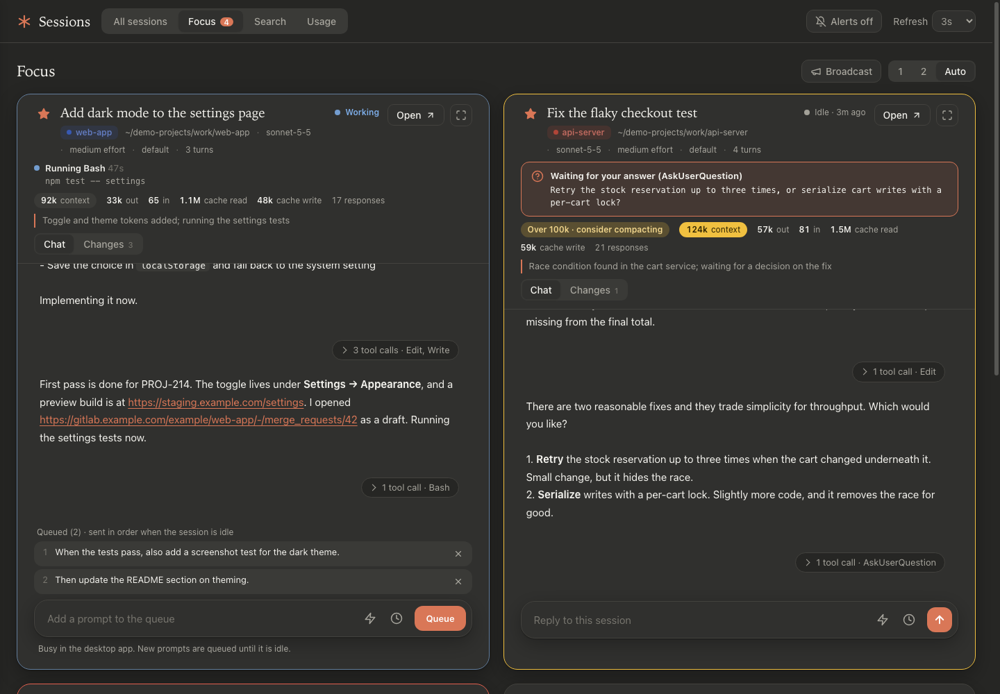
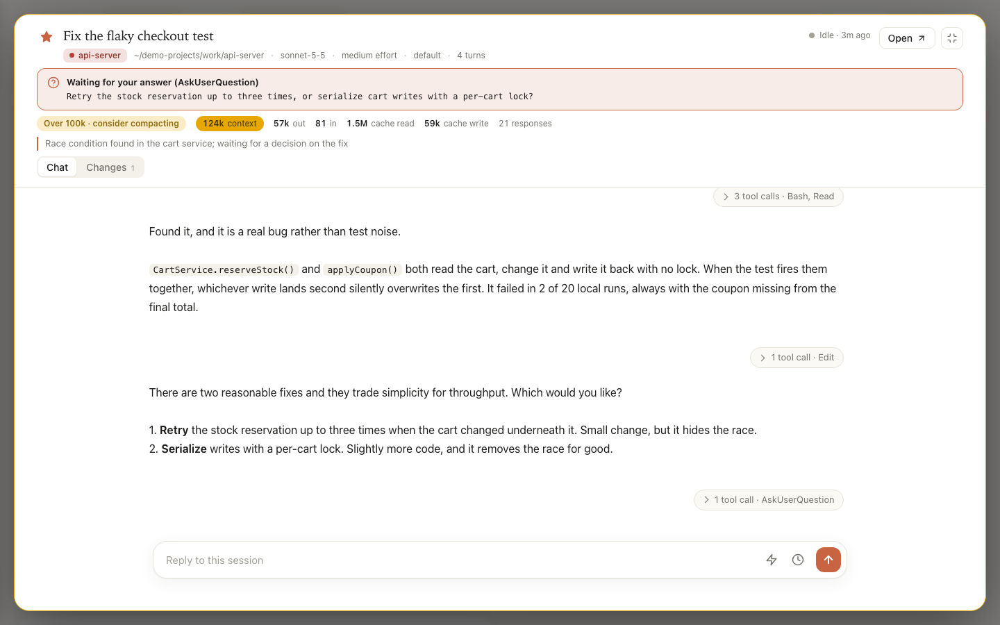
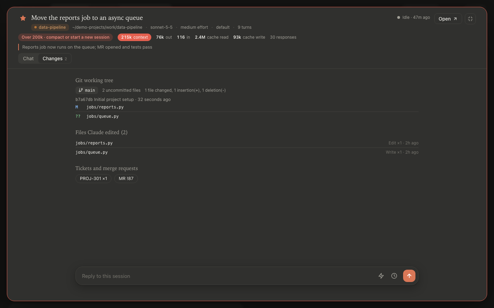
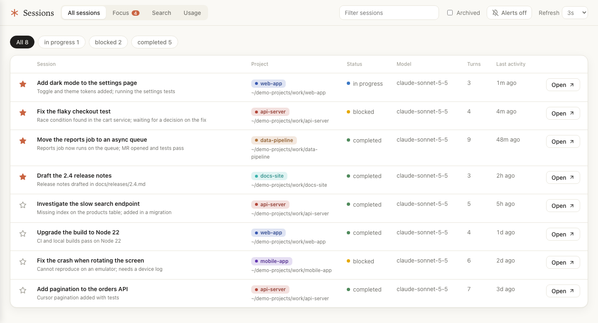
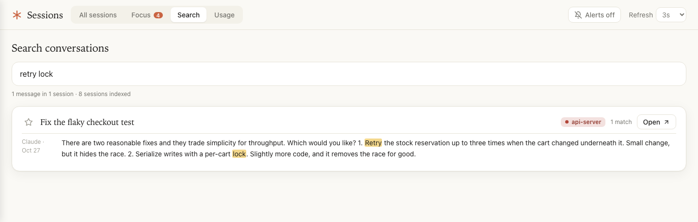
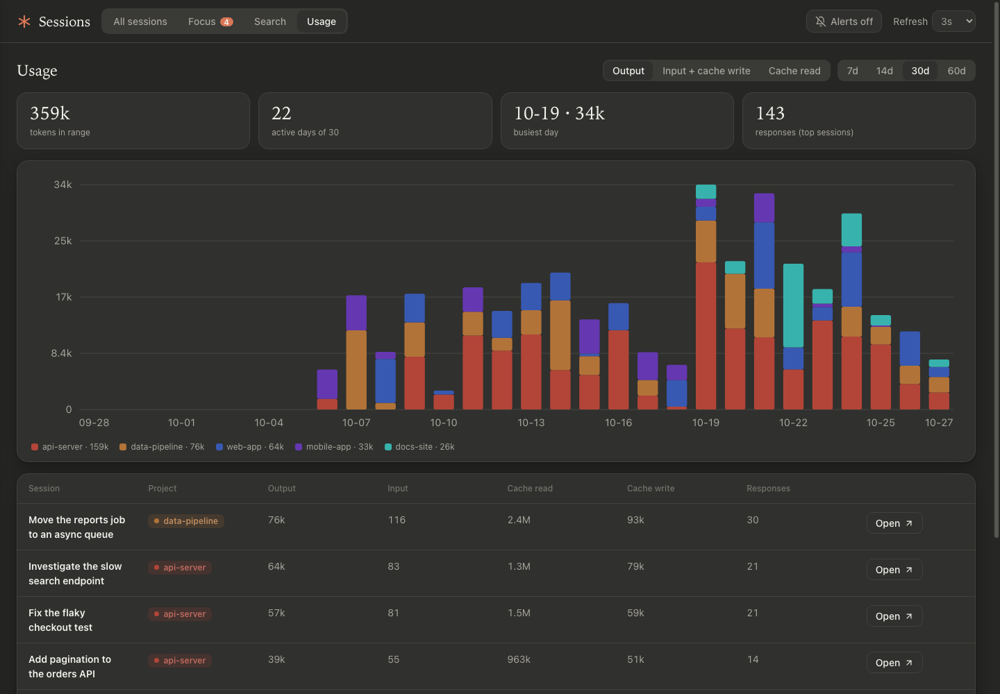

# Claude Session Board

Local web app that lists your Claude desktop Code sessions, opens any of them in the desktop app, and shows live cards for the ones you star.

> Unofficial community project. It is not made by, affiliated with or endorsed by Anthropic. It reads the files the Claude desktop app and Claude Code already write on your machine, and those formats are undocumented and may change without notice.

## Screenshots

All screenshots use the fictional sessions from `npm run demo`. No real conversations are shown.

### Focus: live cards for the sessions you star

Chat with expandable tool calls, a live "now running" strip, token usage with context warnings, the prompt queue and a prompt box.



### Enlarge a card and answer a question

A session that ended on an unanswered question is flagged, and any card can be opened as a large modal. The URL keeps the card open after a reload.



### Changes: git state, edited files, tickets and merge requests



### All sessions



### Search inside every conversation



### Usage over time



## Requirements

- Node.js 20 or newer. There are no dependencies to install.
- The Claude desktop app (Code tab) and the `claude` CLI on your PATH, for sending prompts.
- macOS paths are the defaults. On another system set `SESSIONS_DIR` and `PROJECTS_DIR` (see Configuration).

## Run

```bash
npm start
```

Then open http://localhost:4747. Run `npm test` for the unit tests.

### Try it without Claude desktop

```bash
npm run demo
```

This generates fictional sessions, transcripts and git repositories in a temporary folder (`DEMO_DIR` to choose another) and starts the board on `PORT` (default 4747). Prompts are not sent anywhere in demo mode.

## Pages

- `/` all sessions. Search, status filter and the archived toggle are kept in the URL (`?q=`, `?status=`, `?archived=1`).
- `/focus` one live card per starred session. The 1, 2 or Auto column layout is remembered.
- `/search` full-text search inside every conversation, grouped by session with highlighted snippets.
- `/usage` tokens per day and per project (stacked chart) plus the top sessions.

## Focus cards

- Chat with full-length messages and expandable tool calls (full commands).
- Live strip: the tool Claude is running now with a ticking timer, thinking or writing state, and running subagents.
- Attention banner when a transcript ends on an unanswered question (AskUserQuestion, ExitPlanMode) or a tool has been pending for 45s or more, which usually means it is waiting for approval.
- Token usage with a yellow warning at 100k context and red at 200k.
- Changes tab: git branch, ahead and behind, uncommitted files and diff size for the session folder, the files Claude edited, ticket keys (set `JIRA_BASE_URL` to link them) and merge request links mentioned in the chat.
- Prompt box with a queue, ⚡ shortcuts (stored in `data/snippets.json`) and ⏰ scheduling (once, daily or weekdays).
- 📣 Broadcast queues one prompt on several focused sessions.

## Prompts, queue and schedules

- Prompts run as headless `claude -p --resume <id>` in the session folder with `PROMPT_PERMISSION_MODE` (default `default`, where tools that need approval are denied). Setting it to `acceptEdits` or `bypassPermissions` lets prompts sent from this page edit files and run commands without asking, so only do that on a machine you trust and never expose the server beyond localhost.
- While a prompt is running, or the session is busy in the desktop app, new prompts are queued and sent in order when it is idle. A failed or stopped run pauses the queue until you press Resume.
- Queues persist in `data/queue.json` and schedules in `data/schedules.json`. Due schedules are added to the queue, so they follow the same rules.
- The desktop app may not show turns sent from the board until you reopen the session.

## Slash commands

Typing `/` in a card's prompt box opens an autocomplete list of the commands that work in headless runs: your project commands (`<session folder>/.claude/commands`), your user commands (`~/.claude/commands`), skills, enabled plugin commands and skills, and the built-ins `/compact`, `/context`, `/cost` and `/model`. Arrow keys move, Tab or Enter completes, Esc closes.

- Custom commands and skills run as normal turns.
- Output from `/context`, `/cost` and `/model` is shown in the chat as a command panel.
- `/clear`, `/reset` and `/new` are refused, because headless mode answers them by starting a new session and the board would lose track of the old one.
- Interactive-only commands such as `/help`, `/status` and `/config` are not available in headless mode.

## Alerts

The 🔔 button turns on toasts, a short beep, browser notifications and a tab-title counter when a focused session finishes, asks a question, may need approval, passes 100k or 200k context, is marked blocked, or a prompt fails or pauses the queue.

## Configuration

- `PORT` (default `4747`), `SESSIONS_DIR`, `PROJECTS_DIR`, `DATA_DIR`
- `PROMPT_PERMISSION_MODE`, `CLAUDE_BIN`, `JIRA_BASE_URL`
- `CLAUDE_HOME` (where `.claude/commands`, `.claude/skills` and `.claude/plugins` are read from, default your home folder)

The server binds to `127.0.0.1`, rejects other Host headers, and only accepts POSTs from its own origin. It reads session files and transcripts and never edits them.

## License

[MIT](LICENSE)
